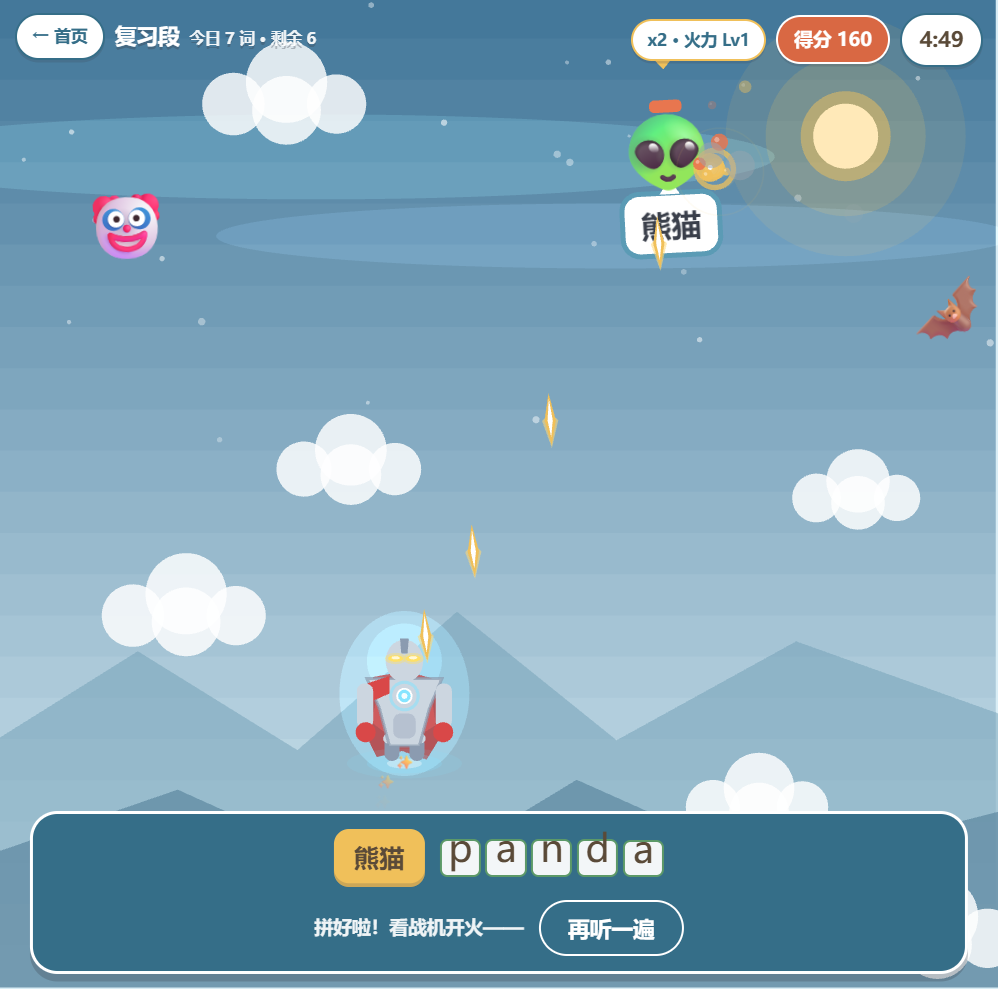
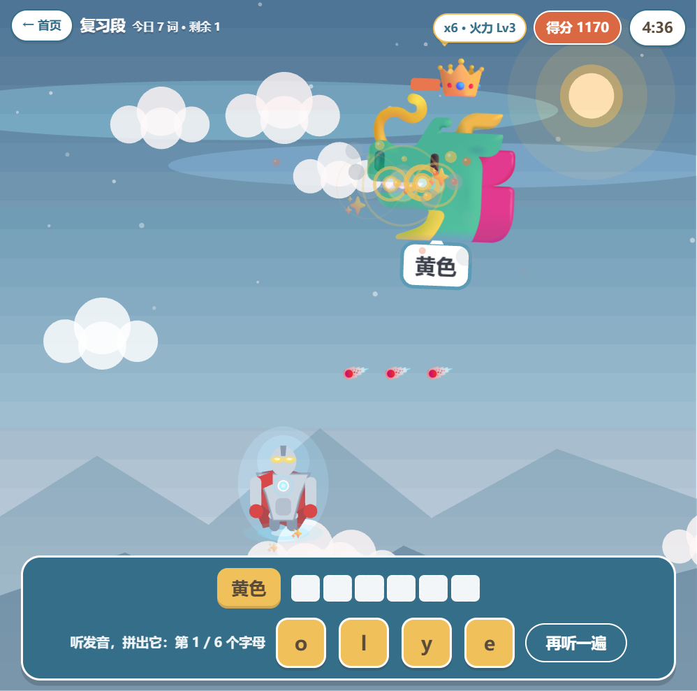
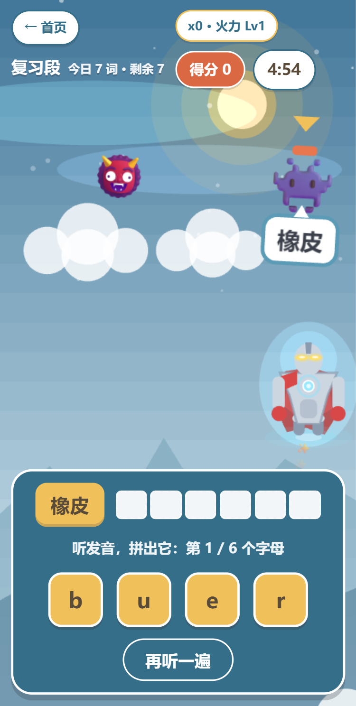
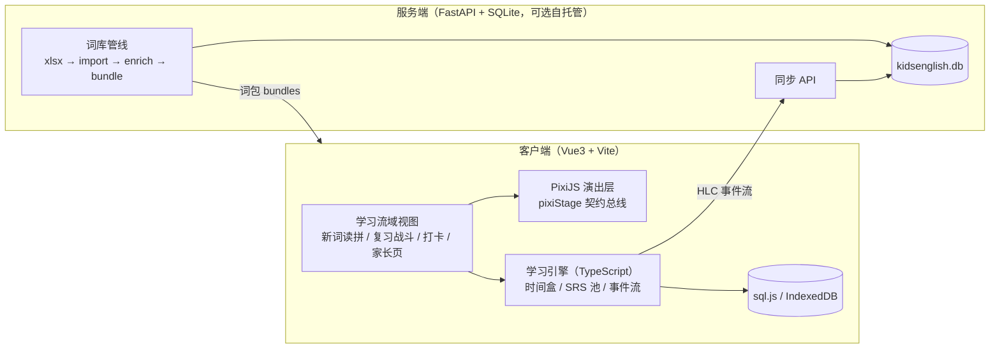

# 战机英语 · KidsEnglish

<p align="center">
  <a href="LICENSE"></a>
  
  
</p>

**把背单词做成雷霆战机**——一款给 1~6 年级到高中孩子的英语单词自学 App。教材同步词库、拼写射击战斗、离线英音音频、多孩档案、家长仪表盘，全部数据本地，零广告零外链。

> An offline-first English word-learning game for K-12 kids (Shenzhen Oxford textbook aligned). Spell the word correctly → your lightning hero fires and destroys the monster. Vue 3 + PixiJS + Capacitor + FastAPI, GPL-3.0.

<p align="center">
  
  
  
</p>

## 为什么做这个

市面上的背单词 App 要么塞满广告和内购，要么联网收集孩子的学习数据。这套东西最初只是给自己孩子做的：**教材同步、完全离线、数据不出设备**。游戏层按经典纵版射击（雷电/雷霆战机）的反馈密度设计——每个字母都是一发子弹，拼对整词触发光波必杀，孩子拼得越准，打得越爽。

## 功能

- **📚 全学段教材词库**：深圳沪教牛津版小学 12 册＋初中 6 册＋人教 2019 高中 7 本，共 25 册现行教材、约 5,400 词，逐单元同步
- **🎮 雷霆战机拼写战斗**：字母级弹幕、波次编队、每 6 词 Boss 战（血条/王冠/弹幕雨）、连击与火力升级、顿帧/震屏/粒子全套打击感
- **🌟 光之巨人演出**：四周光点凝聚登场、矢量绘制（零 emoji 字体依赖，兼容缺字体 Android WebView）、光波击破
- **🔊 离线英音音频**：3,500+ 词英式发音预生成打包，词级音频优先、TTS 兜底，字母链逐音节拼读
- **👨‍👩‍👧 多孩档案**：每孩独立进度/词包绑定/每日目标；家长算术门禁后才可见统计
- **📊 家长仪表盘**：七池进度、学习周报、混淆字母图谱、错题本、打卡热力图、家庭排行榜（可选）
- **🔒 隐私默认**：无账号、无埋点、无外链；数据本地 SQLite/IndexedDB，同步服务可自托管亦可完全不用

## 词库覆盖

| 学段 | 教材 | 册数 | 词数 |
|------|------|------|------|
| 小学 1-2 年级 | 沪教牛津深圳版（2024 新版） | 4 | ~134 |
| 小学 3-6 年级 | 沪教牛津深圳专版（12 单元） | 8 | ~903 |
| 初中 | 沪教牛津（广州深圳版）2024 | 6 | ~1,539 |
| 高中 | 人教版（2019 年版） | 7 | ~2,596 |

词义/音标由 ECDICT 提供主源、人工 curated 校对覆盖；词表与单元归属同步自教材目录（事实性词表）。词卡拓展数据（搭配/同反义/词根）来自 [word-atlas](https://github.com/designfuchen/word-atlas)（CC BY 4.0）。详见 [NOTICE.md](NOTICE.md)。

## 架构



- **学习引擎**：TypeScript 同构折叠器＋事件流＋HLC 重放，客户端离线为先，服务端同步是可选项
- **演出层**：与考核层契约隔离（`stageContract`），游戏再花哨也不碰对错判定
- **词库管线**：教材 xlsx → 导入 → ECDICT/curated 增强 → 版本化 bundle，客户端构建期打包

## 快速开始

### 网页版（开发预览）

```bash
# 服务端（可选；不启动则纯本地模式）
cd server && python -m venv venv && venv/Scripts/pip install -r requirements.txt
venv/Scripts/python -m uvicorn app.main:app --port 8000

# 客户端
cd client/app && npm install && npm run dev   # http://localhost:5173
```

### Android APK

```bash
cd client/app
npm run build && npx cap sync android
cd android && ./gradlew assembleDebug
# 产物：android/app/build/outputs/apk/debug/app-debug.apk
```

需要 JDK 21 与 Android SDK（`local.properties` 指向本机 SDK）。

### 测试

```bash
cd client && npm test            # 学习引擎 183 例
cd client/app && npx vitest run  # 应用层 250 例
cd server && venv/Scripts/python -m pytest  # 服务端 136 例
```

## 项目结构

```
├── client/
│   ├── engine/          # 学习引擎（纯 TS，零 DOM 依赖）
│   └── app/             # Vue3 应用 + Capacitor 壳 + PixiJS 演出
├── server/              # FastAPI 同步服务 + 词库管线（可选部署）
├── docs/                # 需求 brief（冻结）/ 规格 / 美术圣经 / 部署
├── reports/             # 各版本截图与交付说明
└── NOTICE.md            # 第三方数据许可声明
```

## 贡献

Issue / PR 欢迎。改代码前请跑上述测试；涉及词库事实面（词表/释义/例句）的 PR 请注明来源，查无依据不硬凑是本仓词库纪律。

## 许可与声明

- 代码：[GPL-3.0](LICENSE)
- 第三方数据：ECDICT（MIT）、word-atlas（CC BY 4.0）等——见 [NOTICE.md](NOTICE.md)
- 词表按深圳现行教材版本收录（沪教牛津深圳版 / 人教 2019），仅供个人学习用途
- 本项目与教材出版方无关联；App 内不含任何教材原文内容
