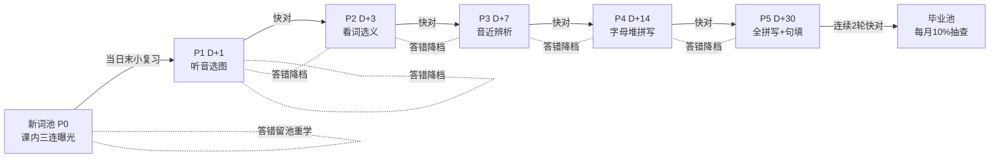

# requirement-brief · 儿童英语学习软件（战机英语）

> **已冻结（G1 确认 2026-10-23，用户原话「对，就这样」）**· 共识神圣，修订须回流用户确认
> **扩围修订（2026-11-05，用户驱动回流）**：多孩子（R10）/起点自选（R11）/家长端周报（R17）/打卡与徽章（R8/R9）属冻结需求未落地项，按 M1-M3 分期补全（见文末「扩围条款（P-14）」）；真新增＝排行榜（自非目标移出，形态已拍板：自我对比＋可选家庭内多孩排名）＋学习行为积分账本（与游戏内得分分离记账）。用户签字留痕：pending-confirmations P-14。
> 2026-10-24 自内部工作区迁入本仓，此后以本文件为唯一事实源。
> 技术栈已拍板（2026-10-24 任务参数）：客户端 Vue3＋Vite＋Capacitor＋PixiJS；后端 FastAPI＋SQLAlchemy＋SQLite WAL 自托管——brief 原 TBD-T2「走 solution-research 复核」视为已被拍板覆盖，不再重开。

## 一句话意图

面向 1-6 年级小学生的英语单词与简单句自学软件：沪教牛津版词表主轴＋拼读主线＋间隔重复引擎＋雷霆战机答题激励，四类移动终端＋自托管轻后端，家长可自定义词库。

## 设计依据（关键事实）

- 深圳主流教材＝沪教牛津版（深圳专版），一年级起点；2025 秋一年级新版教材跳过字母教学直接进句子——拼读主线是对课内的补位而非重复。
- 学科类红线规避：工具型自学产品定位（非课程、非直播），参照百词斩/墨墨先例；商业化阶段再评估备案。
- 记忆引擎实证基线：间隔重复＞集中复习；检索流畅度（反应时间）比纯正确率更能预测长期保持；精熟线取连续两次最高档。

## 逐条需求

- **R1 内容主轴**：1-6 年级通用，沪教牛津深圳专版词表全量（12 学期包＋0 起步包），按「版本/年级/学期/单元」四级组织，扩包不改代码；全量目标、滚动交付（先 0 起步＋一年级，逐学期追加）。
- **R2 学习四线**：拼读主线（字母音→CVC→词族→字母组合→长元音→简单句子）＋课文词表支线＋听力铺垫层＋sight words 并行线，四线汇入同一调度引擎。拼读主线设阶段门：阶段过关率 ≥80% 解锁下一阶段，防跳跃。0 起步包＝26 字母音课程卡＋听力词卡，与词卡共用统一「卡」抽象进同一引擎。
- **R3 间隔重复引擎（7 池模型）**：新词池 P0＋熟练池 P1-P5（间隔 D+1/3/7/14/30）＋毕业池；熟练度＝正误×反应时间自动判定（题型分基线）；答对快升档、答错降一档；毕业＝P5 连续 2 轮「快＋对」；毕业后每月 10% 抽样维护。
- **R4 每日自动计划**：默认 1 关约 15 分钟＝新词 5-8 个（低年级 5、高年级 8，家长可调 3-10）＋复习 15-18 张（新:旧≈1:3）；周末不加新只复习；跳过顺延不惩罚（次日复习上限 20 张按优先级截断）。关内顺序＝复习段→教学段→boss 段；加练设硬顶（默认 2 关/天，家长可调）防刷上头；中途退出断点续学，重进不重头。（2026-10-24 用户拍板修订·双段日计划：日结构改为双段时间盒——新词段 ≤10 分钟（音节块拼读支架教学）＋复习段 ≤5 分钟（答题驱动射击战机游戏，时间盒主控到点即停顺延，一年级 10 张防呆上限）；新词量「按档案」修订为「档案为基线＋带内 3-10 自适应浮动」（三信号消化指数、单日 ±1、家长档位硬天花板可锁定）；原关内三段并入双段（新词段含教学＋boss 收官、复习段＝原复习段游戏化）；周末无新词、跳过顺延、加练硬顶、断点续学不变。调研与四决策记录：`.squad/kids-english-g2/reports/09-每日计划双段改造调研.md`＋pending-confirmations P-06）
- **R5 池-题型绑定与三档变式**：新词池＝教学三连（看图听音→跟点→听音选图）；P1 听音选图；P2 看词选义；P3 音近对比辨析＋词族串烧；P4 拼写（字母集合提示）；P5 全键盘拼写＋句子填空。每池题型备「易/标准/难」三档变式，按该词近 3 次答题快对率自动选档：快对的词吃升级变式（如听音选图→听句选图），勉强的词吃脚手架（二选一/首字母提示），答错的词当日变式题回教学重学形态。高频混淆词对（错因埋点）自动生成对比特训卡，高优先级混入日常复习流。拼写键盘＝**标准 QWERTY 26 键大按键布局**（背单词同时熟悉键盘）：有效字母恒高亮，干扰字母数量随该词熟练度递增（1-2→5→8→毕业阶段全键盘无高亮）；高亮只给字母集合不给顺序；判定大小写不敏感。
- **R6 音近策略**：学习期音近词引入日隔开 ≥3 天；复习期对比辨析卡＋词族串烧。
- **R7 情景探索页**：单元情景大图＋词汇热点（点击物品→词卡：图/词/发音/加入今日学习），情景图自绘不抄课文（每单元 1 张，设计师绘制）。音标不上孩子界面（对小学生是噪音，发音靠听），仅家长端与词库管理显示。多义词配图按教材单元语境选义项（bat 在动物单元配🦇、运动单元配球棒）。
- **R8 战机激励（完全取代宠物）**：拼写答对→操控战机射击怪兽；连对 3 题充能大招；打卡攒碎片解锁战机/子弹涂装；无免费游玩模式（子弹只由答题产生）；卡通怪兽、命中爆星星、无血腥。星星/连击/徽章体系保留。关末 boss 段＝本关新词综合题，不达标换易变式重来（永不判失败）；解锁消耗＝碎片＋星星双消耗（星星经济留消耗口防通胀）。
- **R9 防沉迷与防挫败**：课时制＋关末休息提示；连错 3 题插入低难度缓冲题；连击每周 1 张补签卡；家长设每日提醒时间＋30 分钟窗口，窗口内完成得额外宝箱。
- **R10 多孩子**：跨年龄双号（支持 ≥2 个孩子档案），主界面头像切换，各自独立进度/起点/词包选择/战机机库；切换不设门禁，家长区设门禁。
- **R11 起点自选**：首次使用选起点（0 起步/1上/1下/…/6下）；摸底测评不做，家长可在家长区手动调级。
- **R12 自定义词库（家长只填 3 列）**：下载 xlsx 模板填年级/单元/单词→导入→系统自动补全音标/释义/模板例句/emoji 配图/拼读拆分/TTS 发音；预览确认＋重复检测；ECDICT 查无的进待补队列。
- **R13 发音**：系统英文 TTS 儿童慢速档，默认英式（深圳牛津系）可切美式；上线前孩子实听验收，不过关换预录音库保底。
- **R14 客户端**：iOS＋Android 手机平板四类终端一套代码，平板优先适配；内容包下载后离线可学；不做纯图标化界面（正常图文 UI）。
- **R15 自托管轻后端**：常开 Windows 电脑为主服务器（平板手机不做服务器——iOS 系统禁止，安卓省电机制不可靠）；后端可挂现有服务管理面板管控；远程访问经 Tailscale 组网，不暴露公网；每日自动备份。
- **R16 同步契约**：多设备进度同步，进度只增不减冲突合并；服务器不可达时离线学习，恢复后自动同步。
- **R17 家长端**：同 App 家长模式（两位数算术门禁）：进度周报（池分布/混淆图谱/学习时长）＋自定义词管理＋每日目标＋提醒设置＋手动调级。
- **R18 儿童数据红线**：儿童区无广告/无外链/无付费入口；数据只存本地＋自家服务器，不上第三方云；收集儿童信息须监护人同意（未保法）。

## EARS 完成判定句（关键 8 条）

- **E1** 当孩子答错时，该词降一档并在当日追加 1 道变式题。
- **E2** 当孩子连续 2 次答错同一词时，下一题插入低难度缓冲题。
- **E3** 当服务器不可达时，客户端进入离线学习，恢复连接并回到前台后 60 秒内自动同步。（2026-10-24 G3 用户确认修订：限前台语义——iOS 挂起态无后台执行权，原句「恢复连接后 60 秒内」不可测；修订依据见 `.squad/kids-english-g2/debate/plan-v2.md` 上呈清单）
- **E4** 当单关到期复习卡超过容量时，按到期时间＋错误次数优先级截断，未竟卡顺延次日。
- **E5** 当孩子在提醒窗口内完成当日关卡时，发放额外宝箱奖励。
- **E6** 当拼写答错时，展示正确拼写 3 秒后进入下一题。
- **E7** 当导入词在 ECDICT 查无时，进入待人工补全队列并在预览页标黄。
- **E8** 当算术门禁通过时解锁家长区；未通过时儿童进度数据零暴露。

## 引擎池模型（R3/R4/R5 图示）

## 非目标（MVP 不做）

语音跟读打分（ASR，二期；~~排行榜~~ 2026-11-05 移出：P-14 扩围条款纳入，形态＝自我对比＋可选家庭内）；付费/内购；AI 生图管线（二期可选）；LLM 兜底生成例句（二期）；摸底测评（用自选起点替代）；幼儿园内容线；公网云服务；第三方账号体系。

## 扩围条款（P-14，2026-11-05 用户签字）

- **范围分期**：M1 自学闭环骨架（R10 多孩档案/R11 起点词库选择/R8 打卡记录页/R17 池位统计）→ M2 激励系统（学习行为积分账本/排行榜〔自我对比＋可选家庭内多孩排名〕/成就徽章/错题本）→ M3 家长面（R17 周报/七池可视化/每日目标时长控制）。M4 backlog（单元测验/跟读打分/自然拼读）不入承诺。
- **排行榜红线**：无全服/陌生人排名，无社交功能；默认自我对比（超越昨天的自己），家庭内多孩排名须家长开启。
- **积分边界**：学习行为积分（完成/正确率从既有事件派生，引擎零触碰）与游戏内得分（R8 战机演出得分，P-11 决策 3 纯游戏内不落库）分离记账，游戏表现不污染 SRS 信号。
- **调研依据**：`.squad/kids-english-g2/reports/33-product-gap-survey.md`（四案例拆解＋差距矩阵）。

## 扩围条款（P-15 词库全学段，2026-11-06 用户指令）

- **授权来源**：用户 2026-11-06 指令「补齐 1~6 年级，初一~初三，高一~高三。按深圳今年现行的教材」——R11 起点自选（冻结需求）的全学段延伸；本条即 G1 修订落盘。
- **范围**：词库覆盖小学 1-6（12 册）＋初中 7-9（6 册）＋高中（人教 2019 结构 7 本＝必修一~三＋选择性必修一~四；用户「高一~高三」6 学期按教材本映射呈现，各校进度不一以课本册次为准）。全部按深圳 2026-2027 学年现行版本。
- **版本轮（2026-11-06 调研实证，51jiaoxi 全 23 页实抓）**：小学一二年级＝沪教牛津深圳新版（2024 审定，6 单元疑问句式，25-35 词/册）→ **已上线 1上 v4/2上 v2 按旧版线（12 单元，105/113 词）须换装新版**（旧包资产保留、进度事件不删，客户端册次指针切新版）；小学三~六年级＝旧版深圳专版（12 单元，票 07 全量词表在案）；初中＝沪教牛津广州深圳版 2024 审定新版（滚动期全年级按新版收录）；高中＝人教 2019（必修＋选必）。**51jiaoxi 3 上槽位＝三起线污染**（166 词非深圳线），跨源补收（票 07 §S4）。
- **纪律不变**：收词清单＝词形＋单元归属事实面；释义走 ECDICT＋curated（查无进 E7 零编造）；来源页释义表达/配图/音频零采用；每册对线验证（单元目录独立源交叉）＋课本实物终核留痕。
- **分期**：票 42 小学新版 4 册（含 1上/2上换装）＋客户端册次面 → 票 43 小学旧版 7 册 → 票 44 三上跨源 → 票 45 初中 6 册 → 票 46 高中 7 本。

## 待定项（显式 TBD）

- **T1** 战机完全取代宠物——按「完全取代」推进，G1 确认时可翻案为双轨。
- **T2** 技术栈定稿：**已拍板（2026-10-24，见文件头注记），本条关闭。**
- **T3** 上线时间与预算约束：用户未给，按里程碑推进不设死线。
- **T4** 沪教牛津 12 学期词表的数据源与校对流程——内容工程首项，开工后先做编制流水线试点（1 个学期包走通再复制）。
- **T5** 情景图美术来源与风格（设计师 2-3 候选后拍板）。
- **T6** 远程组网细节（Tailscale 优先，部署阶段定稿）。
